# Industrial Safety System Diagrams

This document is the visual map of the complete project. The diagrams use
[Mermaid](https://mermaid.js.org/) and render directly in GitHub, GitLab, and
Mermaid-enabled Markdown viewers.

## 1. System context

This view shows who uses the system and which external inputs it depends on.

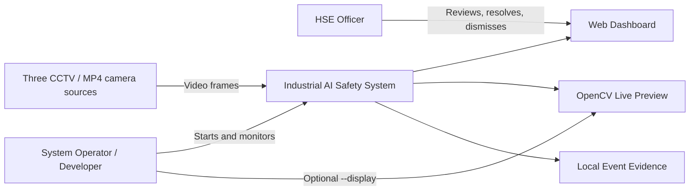

## 2. High-level architecture

The live path is latest-only: camera and AI stages exchange the newest result
instead of building an unbounded processing queue.

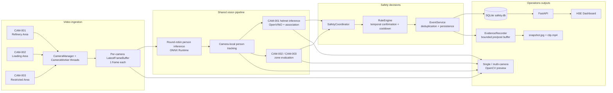

## 3. Low-level component design

This maps the main Python modules and the direction of their dependencies.

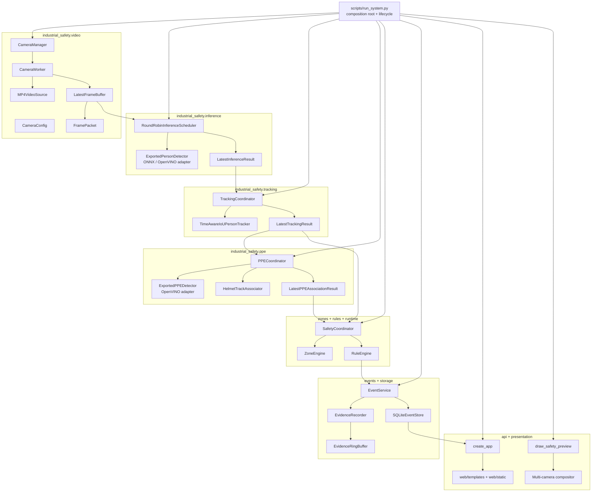

## 4. Runtime threads and bounded handoffs

Each producer can continue without waiting for slower consumers. Latest-result
buffers replace stale data, while only the evidence writer uses a queue—and that
queue is explicitly bounded.

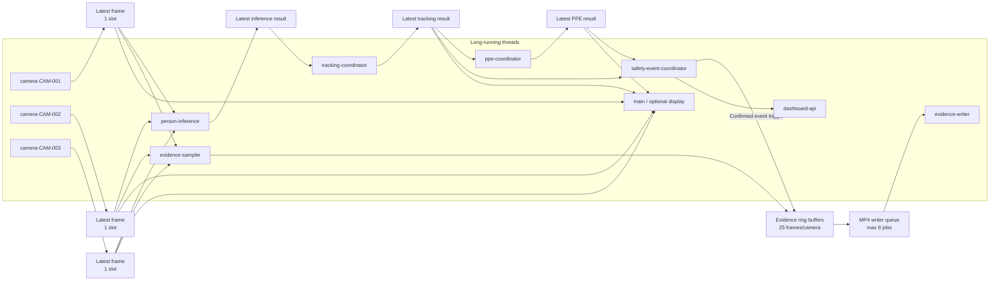

## 5. Camera-specific safety paths

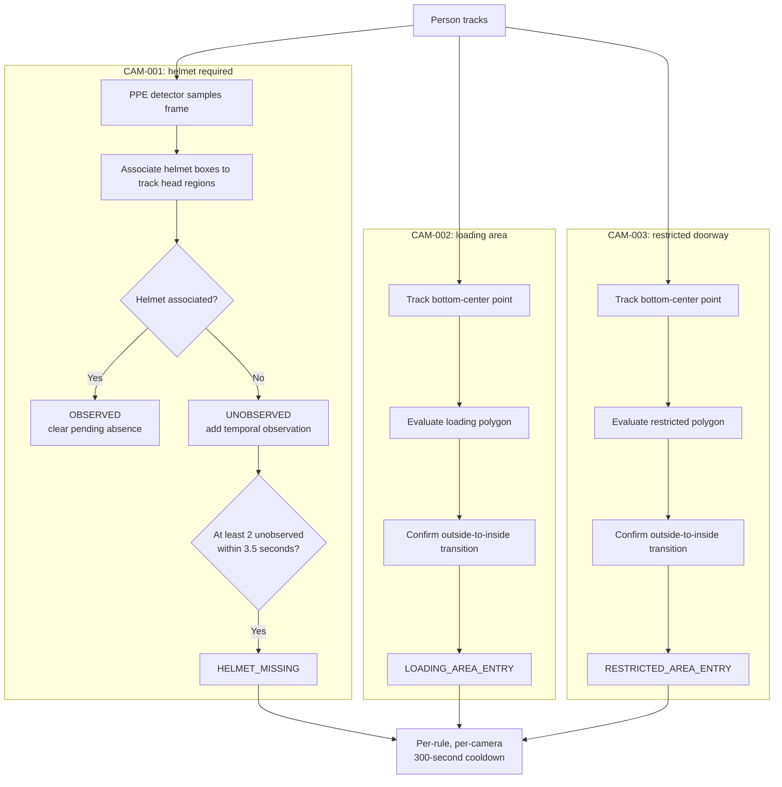

## 6. Confirmed-event and evidence sequence

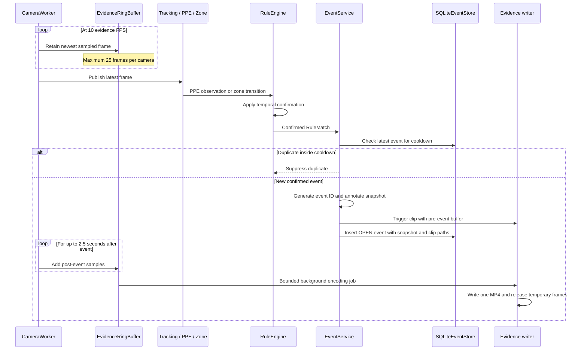

## 7. Event lifecycle

Detection state and human review state are separate. A weak observation never
becomes a database event until the configured rule confirms it.

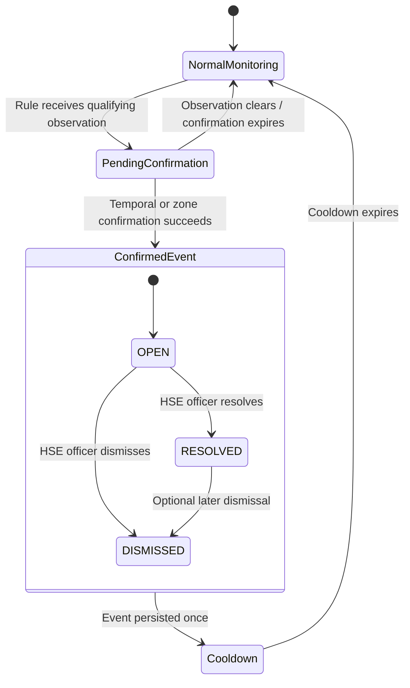

## 8. Database and evidence model

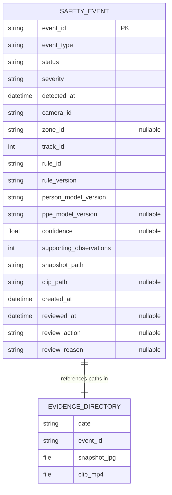

Physical evidence layout:

```text
data/evidence/
└── YYYY-MM-DD/
    └── <event-id>/
        ├── snapshot.jpg
        └── clip.mp4
```

## 9. API and dashboard flow

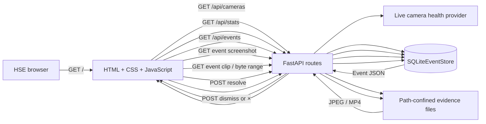

## 10. Display-mode decision flow

The OpenCV display is a read-only presentation consumer. It does not feed data
back into detection, tracking, or safety decisions.

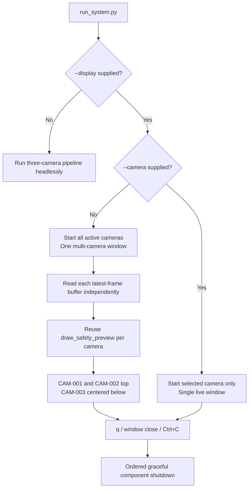

## 11. Startup and shutdown order

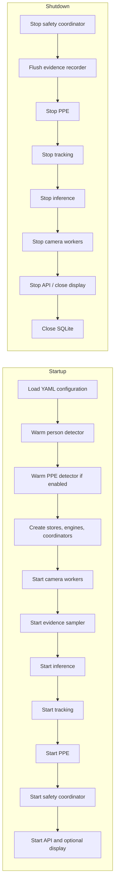

## Reading order

For a quick understanding, read diagrams **1 → 2 → 5 → 6 → 9**. Developers
changing implementation details should additionally use diagrams **3, 4, 8,
10, and 11**.
